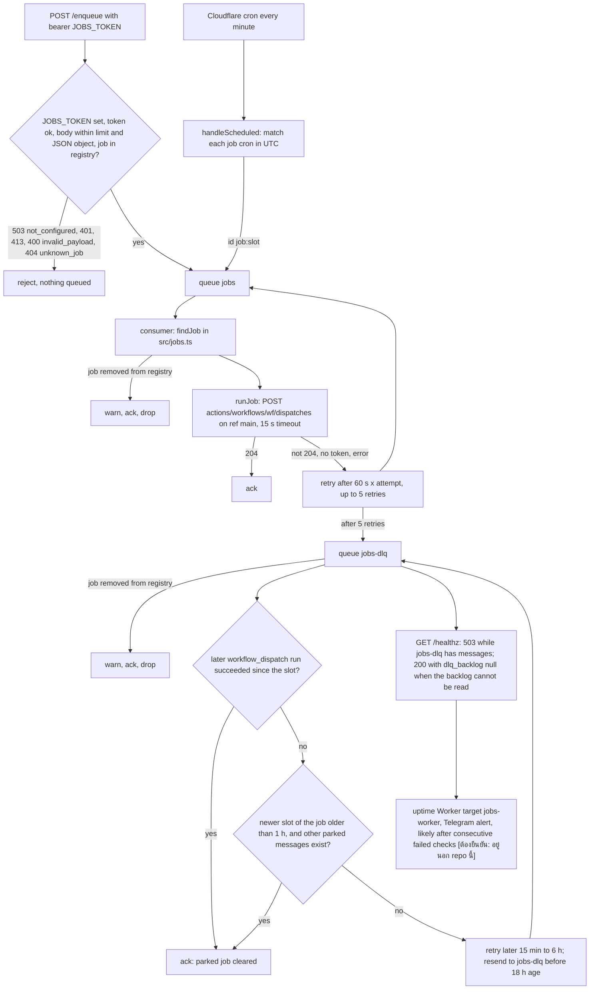

# 01 — Business process (As-Is / To-Be)

platform-jobs-worker (`solo-empire-jobs`) คือ Cloudflare Worker ของ queue plane ตาม ADR-0008 ที่รับ cron ทุกนาทีและ `POST /enqueue` ใส่งานลงคิว `jobs` แล้ว consumer สั่ง GitHub `workflow_dispatch` ให้ workflow ของ repo อื่น พร้อม retry และพักงานที่ล้มเหลวไว้ใน `jobs-dlq` ซึ่งทำให้ `/healthz` ตอบ 503 และ uptime Worker แจ้งเตือน Telegram ผู้ใช้คือ owner และระบบ data/ops ที่ต้องการ scheduler ที่ไม่พึ่ง GitHub cron

Last reviewed: 2026-11-27 · commit `6a72fee`

## As-Is (จากโค้ดวันนี้)

Sources: `src/worker.ts` (`handleScheduled`, `handleRequest`, `handleEnqueue`, `handleQueue`, `runJob`, `handleDeadLetters`, `laterRunSucceeded`, `hasLaterSlot`, `dlqRecheckDelay`, `handleHealth`), `src/jobs.ts` (`JOBS`), `src/cron.ts`, `wrangler.toml`, `README.md`

ข้อเท็จจริงสำคัญจากโค้ด:

- registry ใน `src/jobs.ts` มี 31 งาน ทุกงานเป็น `github_workflow` บน ref `main`; ชนิด `http` (ผ่าน gateway ด้วย `GATEWAY_TOKEN`) มีในโค้ดแต่ยังไม่มีงานใดใช้
- งานที่มี `source: jobs-queue` ส่งเป็น input ให้ workflow แยกพฤติกรรมจาก schedule; workflow ที่ย้ายมา ต้องถอด `schedule:` ของตัวเองออก (กติกาใน `README.md`)
- DLQ ไม่รันงานซ้ำเลย: ตรวจจาก run history ของ workflow เท่านั้น; งานชนิด `http` ถ้ามีในอนาคตจะไม่มี run history จึงไม่ถูกเคลียร์ด้วยหลักฐานการรัน และ consumer จะ re-park สำเนาใหม่ก่อนครบอายุ งานจึงค้างต่อเนื่องจนกว่าจะถูก purge, ถูกแทนที่ด้วย slot ใหม่ตามเงื่อนไข หรือถูกถอดจาก registry
- ตาราง "State" ใน `README.md` (ปรับล่าสุด 2026-11-03/17) ไม่ครบเท่า registry: ไม่มี wiki-pageviews, open-feeds, finance-relay-*, security-signals (ดู G2)

## To-Be (ไม่มี)

ไม่มี To-Be ที่เขียนไว้: `README.md` มีเฉพาะ known gap สองข้อและ owner item เรื่องจำกัดสิทธิ์ token ไม่มี spec/ADR ใน repo นี้ที่กำหนดสถานะเป้าหมายของกระบวนการ (ADR-0008 อยู่ใน `architecture-docs` ไม่ได้อ่านในรอบนี้)

Sources: `README.md` (Known gap, owner item)

## Gap

| ID | As-Is → To-Be | Status | Owner | Evidence |
|---|---|---|---|---|
| G1 | `GITHUB_DISPATCH_TOKEN` เป็น fine-grained token แบบ all-repo → token จำกัด Actions: write เฉพาะ repo ของงาน | todo | owner | `README.md` "Owner item" |
| G2 | ตาราง State ใน README ไม่ครบ 31 งานของ registry → README ตรงกับ `src/jobs.ts` | todo | claude | `src/jobs.ts`; `README.md` §State |
| G3 | manual Run workflow ล้าง job ที่ park ได้แม้ dispatch ของ Worker ยังเสีย → ตรวจแยกได้ | decide | owner | `README.md` "Known gap" (ข้อแรก) |
| G4 | outage กว้างอาจใช้ quota Queues 10,000 ops/วัน (Workers Free) หมด → ลดความเสี่ยงหรือยอมรับ | decide | owner | `README.md` "Known gap" (ข้อสอง) |
| G5 | ไม่มี To-Be ของกระบวนการ → owner กำหนด (เช่น งาน `http`, ช่องทางแจ้งเตือนเมื่อ DLQ นอกจาก uptime Worker) | decide | owner | ไม่มีใน `README.md` / spec |

## Open questions

- uptime Worker target `jobs-worker` ตั้งค่าและแจ้ง Telegram จากที่ใด (ไม่อยู่ใน repo นี้)
- `GATEWAY_TOKEN` และงานชนิด `http` ตั้งใจเก็บไว้ใช้ในอนาคตหรือเอาออก
